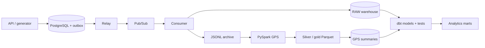
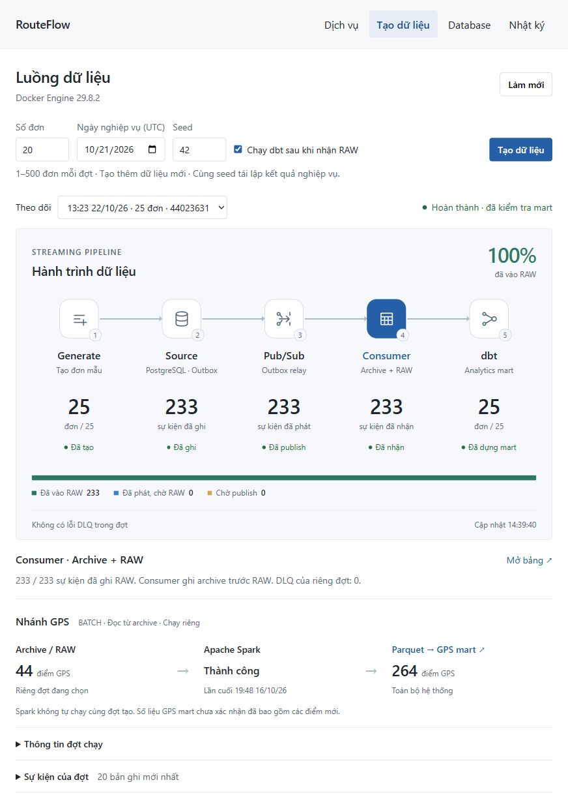
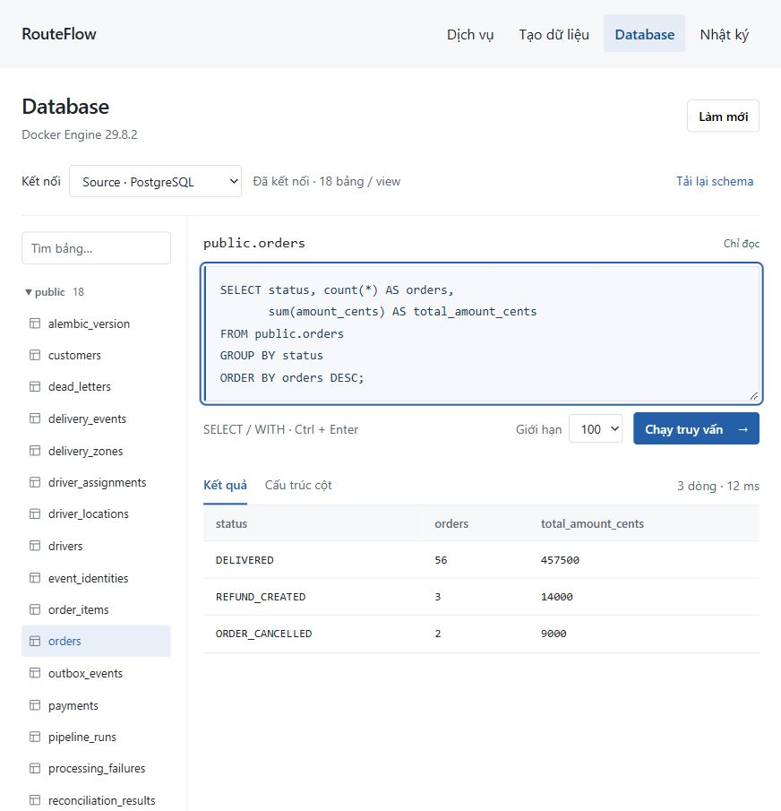

# RouteFlow

A logistics data platform combining event ingestion, warehouse modeling, and distributed GPS processing. Built to reconstruct reliable delivery analytics when events are duplicated, delayed, or delivered out of order.

[](https://github.com/MachHongHai/RouteFlow/actions/workflows/ci.yml)

**Python · PostgreSQL · Pub/Sub · PySpark · dbt · Parquet · Docker · Terraform**

**Status:** verified locally. GCP infrastructure and adapters are implemented; deployment to a real GCP project remains unverified.

## Architecture



The consumer persists original bytes before writing RAW and acknowledging a message. Spark processes archived GPS independently; dbt combines event-derived business models with GPS summaries.

## Engineering highlights

- **Reliable ingestion:** transactional outbox, leased relay claims, confirmed publishing, bounded retries, event-ID deduplication, and collision detection.
- **Recoverable data:** versioned contracts, dead-letter records, immutable archive, replay/backfill, and source-to-mart reconciliation.
- **Analytics modeling:** 22 dbt models and 33 data tests, including incremental order facts, lifecycle reconstruction, and an SCD2 driver dimension.
- **Distributed GPS processing:** native Spark window/Haversine expressions, anomaly flags, date-partitioned Parquet, and transactional summary replacement.
- **Local console:** service controls, bounded sample generation, live batch tracing, schema browsing, and a read-only SQL editor.

<details>
<summary>Console screenshots — pipeline and SQL workspace</summary>




</details>

## Run locally

Requires Docker with Compose **2.17+**. Allow approximately **8 GiB Docker memory** for the optional Spark branch. No cloud account is needed.

```bash
git clone https://github.com/MachHongHai/RouteFlow.git
cd RouteFlow
docker compose --profile console up -d --build
```

Open [Console](http://127.0.0.1:58090) or [API docs](http://127.0.0.1:58000/docs). In **Tạo dữ liệu**, generate a small batch with dbt enabled; follow it from Outbox to RAW and Mart. In **Database**, explore Source/Warehouse tables or run SELECT/WITH queries.

Initialization applies migrations and provisions the local warehouse and emulator. All published ports bind to loopback; Compose credentials are for local demonstration. Containers start explicitly and retain data in named volumes.

For the maintainer's Windows D/E storage policy, use the [guarded workstation setup](docs/DISK_STORAGE.md). Other machines use the portable base Compose file.

Optional distributed Spark demo (requires [uv](https://docs.astral.sh/uv/)):

```bash
uv sync --frozen
docker compose --profile spark up -d --build spark-master spark-worker
uv run python scripts/local_pipeline.py --orders 20 --spark
```

This generates additional data, waits for ingestion, submits Spark, builds dbt models, and reconciles Source against Mart. Spark UI: [localhost:58080](http://127.0.0.1:58080). GPS distances are estimates from synthetic coordinates.

## Validate

```bash
uv sync --frozen
uv run ruff check .
uv run ruff format --check .
uv run mypy routeflow
uv run pytest
```

The default suite skips infrastructure-dependent tests. [Testing](docs/TESTING.md) covers PostgreSQL/Emulator integration, streaming E2E, Spark numerical/Parquet tests, frontend checks, and Terraform validation. [Validation evidence](docs/VALIDATION.md) separates observed local results from unverified cloud behavior.

## Repository

```text
routeflow/       Business API, ingestion, storage, console, and Spark jobs
migrations/      Versioned PostgreSQL schema migrations
dbt/             Staging, intermediate, marts, macros, and data tests
tests/           Unit, contract, integration, E2E, and Spark suites
scripts/         Local orchestration, storage guards, backups, and benchmarks
infra/terraform/ Optional GCP infrastructure modules
docs/            Architecture, operations, decisions, and validation evidence
```

## Documentation

[Architecture](docs/ARCHITECTURE.md) · [Data model](docs/DATA_MODEL.md) · [Spark design](docs/SPARK_ARCHITECTURE.md) · [Analytical SQL](docs/ANALYTICAL_QUERIES.sql)

[Local setup](docs/LOCAL_DEVELOPMENT.md) · [Console guide](docs/LOCAL_CONSOLE_VI.md) · [Recovery](docs/FAILURE_RECOVERY.md) · [GCP status and gaps](docs/PROJECT_GAPS_VI.md)

[Documentation index](docs/README.md) · [Contributing](CONTRIBUTING.md) · [Portfolio and interview notes](docs/PORTFOLIO.md)
