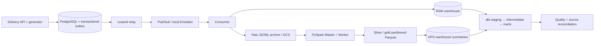

# RouteFlow — Real-Time Logistics Data Platform

A runnable Data Engineering portfolio project for a bounded delivery business: transactional
FastAPI/PostgreSQL operations, at-least-once Pub/Sub ingestion, distributed PySpark GPS processing,
partitioned Parquet, and tested dbt analytical models. Local execution needs no cloud account.

The business problem is reconstructing trustworthy delivery, payment and driver-movement analytics
when events can be duplicated, delayed, malformed or delivered out of order. This repository
implements recovery paths as working code and verifies final data, not just successful startup.

**Deployment status:** verified locally; not connected to a real GCP project or deployed to GCP.
Start with the [Vietnamese GCP guide](docs/GCP_GETTING_STARTED_VI.md) and
[current gaps](docs/PROJECT_GAPS_VI.md) before treating the cloud configuration as operational.



## Implemented production patterns

- Validated order/payment/driver transitions with transactional outbox and request idempotency.
- Relay claiming via `SKIP LOCKED`, ownership leases, broker confirmation and bounded backoff.
- Durable archive before acknowledgement, identity-collision detection, DLQ and explicit replay.
- Event-ID deduplication, aggregate-version lifecycle reconstruction and late-event incremental upserts.
- Replay/backfill metadata, source-to-mart metric/record reconciliation and intentional failure probes.
- Spark native Haversine/window calculations, broadcast references, anomaly flags and partitioned Parquet.
- Transactional replacement of GPS summaries, working SCD2 and downstream GPS/order business tests.
- Modular opt-in GCP infrastructure, private push consumption, WIF deployment and cost controls.

## Stack

Python 3.12, FastAPI, SQLAlchemy 2, Alembic, PostgreSQL 16, Google Pub/Sub/Emulator, dbt Core with
Postgres/BigQuery adapters, GCS, Spark 4.0.2/PySpark with Java 17, Terraform, Docker Compose, pytest,
Ruff and mypy. `uv.lock` pins application dependencies; PostgreSQL and emulator images include digests.
No Kafka, Kubernetes, always-on cloud worker or paid Spark cluster is required.

## Run locally

Local management UI: click **Start** on the **routeflow** group in Docker Desktop, then open
[RouteFlow Console](http://127.0.0.1:58090) to control the eight services, inspect
read-only data/logs and review storage. The **console** container publishes port **58090**.
First-time setup/update uses `scripts/start-console.ps1 -Build`; see the [console guide](docs/LOCAL_CONSOLE_VI.md).

On this Windows workstation, keep project/cache data on D and Docker bulk data on E. Use the
guarded PowerShell wrapper in [storage placement](docs/DISK_STORAGE.md) to set cache/temp paths
and check Docker's destination before starting builds.
If containers disappear after a Desktop update, use the [recovery runbook](docs/DOCKER_RECOVERY_VI.md)
to locate the existing disk and verify backups before rebuilding.

```bash
uv sync --frozen
docker compose up -d --build
docker compose exec -T api python -m routeflow.generator --orders 20 --seed 42
docker compose exec -T api python -m routeflow.cli wait-ingestion
docker compose exec -T api python -m routeflow.cli dbt
docker compose exec -T api python -m routeflow.cli reconcile --grace-seconds 0
```

Initialization applies migrations and creates emulator/warehouse resources automatically. API docs:
[127.0.0.1:58000/docs](http://127.0.0.1:58000/docs). The local source and warehouse SQL ports are 55432
and 55433. Database credentials are demonstration-only Compose defaults. See `.env.example` for
host execution and [local development](docs/LOCAL_DEVELOPMENT.md) for the full command sequence.

Enable the Spark branch and run the complete orchestration:

```bash
docker compose --profile spark up -d --build spark-master spark-worker
uv run python scripts/local_pipeline.py --orders 20 --spark
```

The Spark UI is [127.0.0.1:58080](http://127.0.0.1:58080). Historical GPS backfill submits an actual
standalone job; use the generated UTC dates:

```bash
uv run python -m routeflow.cli spark-backfill --from 2026-10-15 --to 2026-10-15 --explain
docker compose exec -T api python -m routeflow.cli dbt
docker compose exec -T api python -m routeflow.cli metrics
docker compose --profile spark down
```

## Data flow and model grain

A request changes an order and its outbox event in one source transaction. The relay publishes
confirmed messages; the consumer durably archives exact original bytes, validates the versioned
contract and identity, then commits RAW before ack. dbt deduplicates events and selects the highest
aggregate version for current state. Spark independently reads archived GPS, orders driver histories,
calculates estimated segments, writes date-partitioned Parquet and replaces affected gold summaries.

| Mart | Grain |
|---|---|
| `fact_order` | One order |
| `fact_payment` | One simulated payment, including its refund state |
| `fact_delivery` | One delivered order with SCD2 driver key at assignment |
| `fact_driver_performance` | Driver / UTC delivery date / hour |
| `fact_driver_mobility` | Driver / UTC date from Spark GPS estimates |
| `fact_zone_mobility` | Zone / UTC date / hour from Spark |
| `dim_driver` | Driver profile version with half-open validity interval |

Customers, restaurants, zones and dates have dimensions too. [Data model and lineage](docs/DATA_MODEL.md)
explains keys, incremental predicates and SCD2 behavior. [Spark design](docs/SPARK_ARCHITECTURE.md)
explains date boundaries, rejected data and immutable Parquet generations.

## Test and inspect

```bash
uv run ruff check .
uv run mypy routeflow
uv run pytest
docker compose config --quiet
```

For the real PostgreSQL/Emulator/dbt suite, set `RUN_INTEGRATION=1` in your shell, then run
`uv run pytest tests/unit tests/contract tests/integration tests/e2e -q`. Tests create separate
databases suffixed `_test`. Spark numerical/Parquet tests run in its optional container:

```bash
docker compose --profile spark run --rm --no-deps -e RUN_INTEGRATION=1 --entrypoint python spark-job -m pytest tests/spark -q -o cache_dir=/tmp/pytest-cache
```

[Testing](docs/TESTING.md) includes PowerShell syntax and Terraform checks.
[Validation evidence](docs/VALIDATION.md) records actual runs separately from untested cloud paths.
Development verification includes real streaming E2E, repeated replay/backfill, Spark worker
execution and numerical GPS tests. No cloud throughput, coverage percentage or cost saving is claimed.

## Analytical questions

[Runnable queries](docs/ANALYTICAL_QUERIES.sql) answer mean delivery duration/SLA by zone,
cancellation and payment-failure rates, demand by hour, late-event fraction and estimated driver
movement with quality flags. For example:

```sql
select z.name, avg(d.delivery_minutes) as average_delivery_minutes
from analytics.fact_delivery d
join analytics.dim_zone z on d.zone_id = z.zone_id
group by z.name;
```

The result contains one row per observed zone, with minutes calculated from business timestamps.
It describes this synthetic workload; it is not evidence about a real delivery business.

## Reliability guarantees and limits

Delivery is **at least once**. Duplicate RAW attempts are expected. Local logical RAW is protected
by an event-ID primary key, BigQuery staging deduplicates append loads, and facts upsert on business
keys. An older lifecycle event cannot overwrite a newer version. The ingestion-time overlap does
not discard newly ingested historical order events. Spark's late-data range replacement also
rebuilds subsequent segment endpoints, including midnight crossings.

The source/control database is a single availability dependency. Cloud BigQuery per-message batch
loads are deliberately low-volume and subject to load-job quotas. Cloud relay execution is scheduled,
so API-to-broker latency can extend until the next job. RAW/archive retention bounds historical
recovery. GPS estimates are not road distance or measured working time; repeated simulation runs
do not constitute a real historical shift calendar. Cloud IAM/API behavior still needs an authorized
account smoke test. See [operations](docs/OPERATIONS.md) and [recovery](docs/FAILURE_RECOVERY.md).

## Cloud, cost and deployment

`infra/terraform` defines Pub/Sub/DLQ, BigQuery layers/tables, an archive bucket, private Cloud Run
services, bounded jobs, Workflows/Scheduler, service identities, WIF and monitoring/budget controls.
GCP deployment is opt-in; no script applies infrastructure automatically. Use an external free-plan
PostgreSQL source if appropriate instead of requiring Cloud SQL. No paid Spark service is provisioned.

Read [deployment](docs/CLOUD_DEPLOYMENT.md) and [verified cost assumptions](docs/CLOUD_COSTS.md)
before enabling anything. Defaults include one maximum service instance, an initially paused daily
schedule, short broker retention, storage expiration and query limits. Budgets are alerts, not a
spending cap; the large dual-adapter container may exceed Artifact Registry's small storage allowance.
The safest zero-billing demonstration is local Compose.

## Repository

`routeflow/` holds the shared business, API, broker, storage, operations and Spark implementation.
`migrations/` contains Alembic revisions; `dbt/` contains warehouse models/tests/macros; `scripts/`
provides local orchestration and benchmarks; `infra/terraform/` contains data/runtime modules;
`tests/` contains unit, contract, integration, E2E and Spark tests; `.github/workflows/` contains
validation and manual deployment; `docs/adr/` records concrete architectural trade-offs.

## Portfolio use

Suggested CV bullets grounded in locally verified functionality:

- Built a delivery analytics platform with PostgreSQL transactional outbox, Pub/Sub Emulator,
  idempotent ingestion, contract validation, DLQ replay and source-to-warehouse reconciliation.
- Implemented distributed PySpark GPS processing with native Haversine/window expressions,
  anomaly checks, partitioned Parquet and repeatable warehouse backfills.
- Modeled delivery/payment marts and an event-sourced SCD2 dimension using dbt; validated duplicate,
  crash, late-event and out-of-order recovery with automated integration and E2E tests.

Do not claim these services were deployed on GCP until you actually deploy and test them.
[Interview guide](docs/INTERVIEW_GUIDE.md) explains the design using the implementation.
