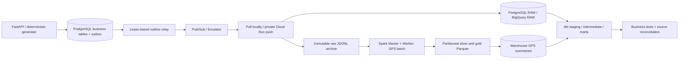

# RouteFlow architecture

RouteFlow is a bounded logistics simulation with two data-processing branches. The streaming
branch reconstructs orders and financial state; Spark owns historical GPS sequence calculations.
They share the same source system, contracts, archive and warehouse. No GCP account is needed locally.



The consumer archives exact message bytes before validating and committing RAW. It returns success
only when RAW is durable or a durable DLQ row preserves the input. Failures in both storage and the
control database cause redelivery. Pub/Sub's native DLQ is the cloud safety net if the control
database itself is unavailable. The emulator tests application-level quarantine, not native DLQ IAM.

An `event_identities` row prevents a producer from reusing an ID for different content across both
warehouse adapters. It is a collision guard, not a completion marker. A crash between identity
registration and RAW persistence therefore cannot suppress ingestion on retry.

Local RAW has an event-ID primary key plus a delivery-attempt audit table. BigQuery uses append load
jobs and staging deduplication; a crash may create multiple RAW rows but curated facts have one
business grain. The design guarantees at-least-once delivery, not end-to-end exactly-once execution.

```mermaid
sequenceDiagram
  participant App
  participant PG as PostgreSQL
  participant Relay
  participant Pub as Pub/Sub
  participant C as Consumer
  participant A as Archive
  participant W as Warehouse
  App->>PG: BEGIN; business change + outbox; COMMIT
  Relay->>PG: Claim unpublished rows with SKIP LOCKED + lease
  Relay->>Pub: Publish and await broker confirmation
  Relay->>PG: Mark published (crash before here permits duplicate)
  Pub->>C: Deliver / redeliver
  C->>A: Persist original bytes
  C->>PG: Guard immutable event identity
  C->>W: Commit RAW
  C->>Pub: Ack / HTTP 204 (crash before here permits duplicate)
```

Each service is independently restartable. The source database also stores DLQ records, retry
counters, pipeline runs and reconciliation details. This control plane is intentionally a single
PostgreSQL dependency rather than a distributed coordinator.

Cloud Run uses scale-to-zero private services. A daily, initially paused Scheduler calls Workflows,
which runs bounded `produce` and `transform` jobs. `produce` checks actual RAW event identifiers
before transformations proceed. A paid distributed Spark service is never provisioned; an optional
external runner can be inserted between the two jobs. See [cloud deployment](CLOUD_DEPLOYMENT.md).
