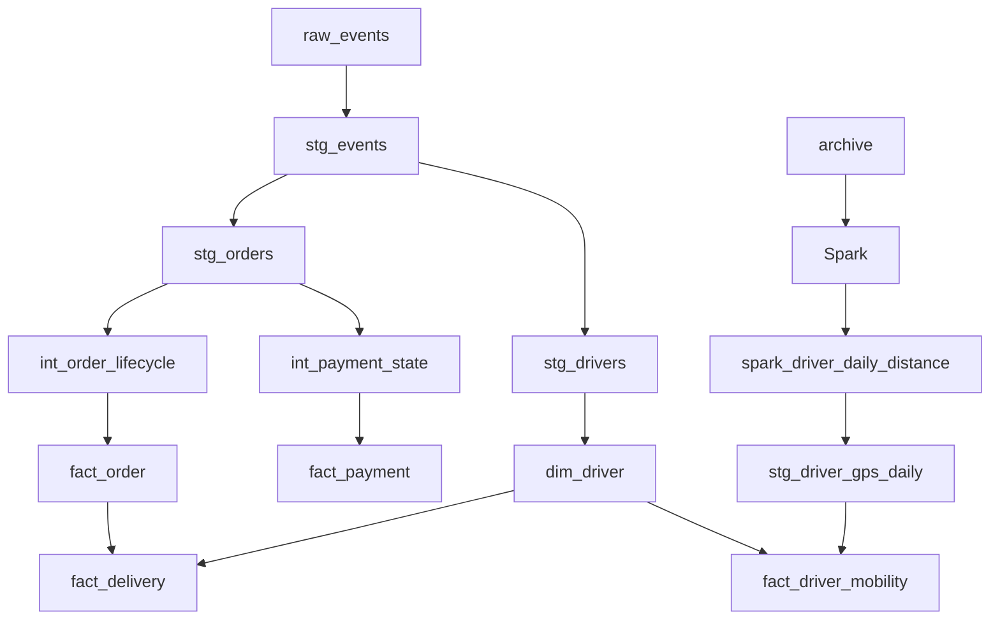

# Source and warehouse model

Operational entities are defined in `routeflow/models.py`; frozen Alembic revisions live in
`migrations/versions`. IDs are UUID strings, money is integer cents in a single simulated currency,
and all event timestamps represent UTC. Coordinates are decimal degrees. This is a fictional
business workload, not a payment system or a map-matching service.

The source has customers, restaurants, zones, drivers, orders, items, payments, assignments,
locations, delivery events and refunds. Foreign keys enforce references. Positive-money/quantity
checks, unique payment/refund/order request keys and partial unique active-assignment indexes
protect core invariants. Application transitions lock an order and its driver. A cancelled order
cannot be delivered; a refund needs a confirmed unrefunded payment. Drivers are released on
delivery/cancellation. A driver cancellation permits reassignment.

| Model | Grain / key | Behavior |
|---|---|---|
| `stg_events` | One `event_id` | Earliest ingestion wins after identity validation |
| `int_order_lifecycle` | One `order_id` | Latest aggregate version, lifecycle timestamps from all retained history |
| `fact_order` | One `order_id` | Incremental upsert; complete order snapshot |
| `fact_payment` | One `payment_id` | Latest outcome, including refunds |
| `fact_delivery` | One delivered `order_id` | Delivery duration, SLA and driver key at assignment time |
| `fact_driver_performance` | Driver / UTC date / delivery hour | Completed deliveries and estimated occupied minutes |
| `dim_customer`, `dim_restaurant`, `dim_zone` | One natural ID | MD5 surrogate key; latest reference record |
| `dim_driver` | Driver / profile version | SCD2 surrogate key, `[valid_from, valid_to)` |
| `dim_date` | UTC calendar date | 2020-01-01 through 2035-12-31 |
| `fact_driver_mobility` | Driver / UTC date | Spark distance estimates and quality metrics; current profile key |
| `fact_zone_mobility` | Zone / UTC date / hour | Spark observed drivers, points, distance estimates |

`dim_driver` is an event-sourced SCD2 implementation, not a decorative snapshot definition. Profile
updates emit increasing versions. SQL `lead()` rebuilds intervals even if an intermediate profile
arrives late. Multiple updates at the same timestamp can produce a zero-length historical interval;
only the last version applies at that instant. An explicit dbt test requires exactly one current
row per driver and valid interval bounds.

`fact_order` selects affected IDs using an ingestion watermark with a three-day overlap; for those
IDs it reconstructs the latest version from all retained RAW history. PostgreSQL uses transactional
delete+insert, BigQuery uses MERGE. Repeated builds do not append facts. Very old event timestamps
are still picked up when newly ingested. BigQuery partition expiration can remove such historical
data; restore retention first when performing old backfills.

